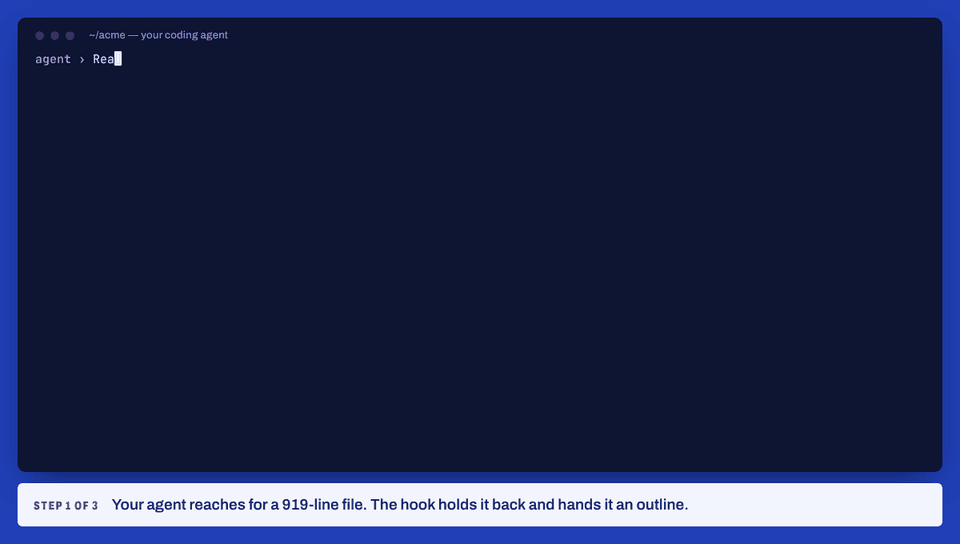
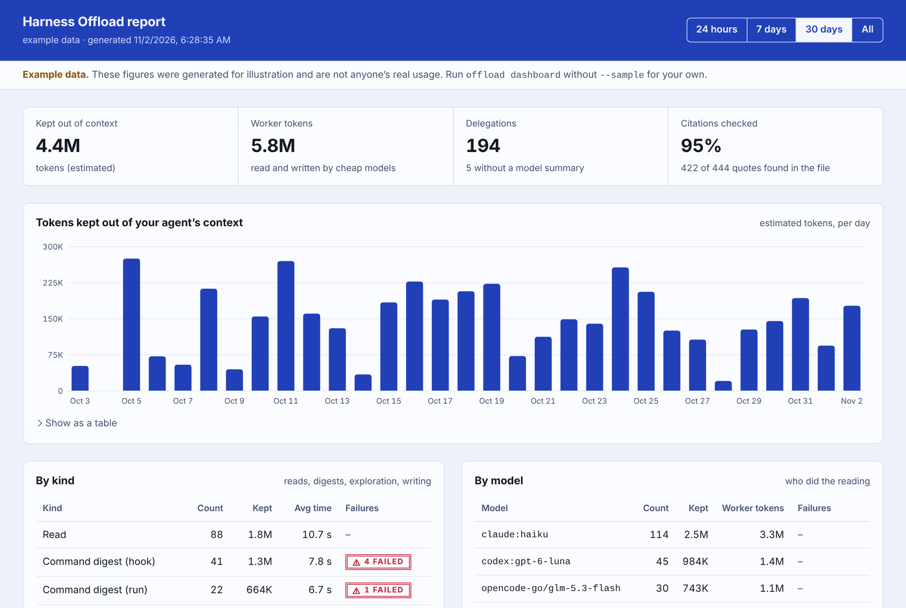

<div align="center">

# Harness Offload

**Keep huge files, long logs and repo-wide searches out of your coding agent's context.**<br>
A small model on the plan you already pay for reads them and hands back the answer, with every line reference checked.

[](https://github.com/levgiorg/harness-offload/actions/workflows/ci.yml)
[](https://www.npmjs.com/package/harness-offload)
[](LICENSE)

Claude Code · Codex · Gemini CLI · Copilot CLI · Cursor · OpenCode · Pi · Qwen Code · Crush · Kilo · Windsurf · any MCP client



<sub>Real outputs, replayed: worker <code>claude:haiku</code> on a Claude plan.</sub>

</div>

## Install

```bash
npx harness-offload@latest install
```

It asks which of your agents to set it up in (Claude Code, Codex, Cursor, Gemini CLI, Copilot CLI, Qwen Code,
Crush, Pi, OpenCode, Kilo — the ones it finds are ticked) and whether for all your projects or just this one,
shows exactly what will change, and installs only after you say yes. Each agent then reads with **its own small
model on the plan you already pay for**: Claude Code → Haiku, Codex → gpt-6-luna, Gemini CLI → Flash-Lite…

**Only Claude Code?** `claude plugin install harness-offload --marketplace levgiorg/harness-offload`

<details>
<summary>What it changes, and where</summary>

| Agent | What happens | Where |
|---|---|---|
| Claude Code | `claude plugin install … --scope user` (or `project`) | managed by Claude Code (`~/.claude`, or the project's `.claude/settings.json`) |
| Codex · Copilot CLI · Qwen Code · Pi · Devin | their own plugin/extension command | managed by each agent |
| Gemini CLI | a new extension folder | `~/.gemini/extensions/harness-offload/` |
| Cursor | a copy of the plugin | `~/.cursor/plugins/local/harness-offload/` |
| OpenCode · Kilo | one one-line plugin file | `~/.config/opencode/plugins/`, `~/.config/kilo/plugin/` |
| Crush | 2 hooks and a guide added to your settings (backup kept) | `~/.config/crush/crush.json` |
| Offload itself | its own copy, so agents don't depend on the npx cache | `~/.local/share/harness-offload/` |

Nothing runs at `npm install` time; only `install` changes anything. Details per agent: [docs/hosts.md](docs/hosts.md).
</details>

- **Check:** `npx harness-offload doctor` · **Update:** run the install command again (it says `updated 0.2.0 → …`)
- **Change who reads** (another model, an API key, a local model): `npx harness-offload model …` ([18 providers + local](docs/backends.md)), or `/harness-offload:setup` in Claude Code
- **No questions** (scripts, CI, or from inside an agent): `npx harness-offload@latest install --yes [--agents claude,codex] [--scope project]`
- **Remove:** `npx harness-offload uninstall` (asks; your settings stay unless you say so) · Claude Code alone: `claude plugin uninstall harness-offload@harness-offload`
- **Let your agent do it:** paste *"Run `npx harness-offload@latest install --dry-run`, show me what it would change, then run it with `--yes --agents <this agent>`."*

## What it saves

| Your agent asked for | Would have read | Got back | Facts found |
|---|---:|---:|---:|
| Questions about a 919-line module | 9,666 tokens | 453 | 4 / 4 |
| A 2,323-line CI log with two failures | 32,771 | 659 | 3 / 3 |
| Pytest file written from a reference test | 759 | 54 | 28 / 28 tests pass |

Measured with a real worker model — [docs/VALIDATION.md](docs/VALIDATION.md).

## How you use it

You mostly don't: hooks catch the expensive moves and steer the agent. When you or the agent want it directly:

```bash
offload read -q "how are late fees applied?" src/ledger.ts   # answer + checked path:line citations
offload explore "where is the retry policy configured?"      # read-only search across the repo
offload run -- npm test                                      # long output → digest + verbatim errors
offload task review-sql src/db/                             # your own task: your instructions, checked citations
offload dashboard --open                                     # what stayed out of your context
```

Your own tasks are a few lines of config — [docs/commands.md](docs/commands.md#your-own-tasks).



## How it works

1. **A hook holds the big read back.** A full read over 600 lines (or a `cat` of one) gets an outline and cheaper options instead.
2. **A small model reads it.** `offload` sends the file to the worker with deny-all permissions and secrets removed.
3. **The answer is checked.** Every `path:Lx-Ly` must quote text that really is there, or it is flagged.
4. **Noisy output becomes a digest.** Verbatim error lines and the tail come from a script; the model only adds a summary.

Everything fails open: if no worker is available, your agent's tools work as before.

## Docs

| | |
|---|---|
| [Harnesses](docs/hosts.md) | what each integration does, install notes |
| [Backends](docs/backends.md) | `@host`, OpenCode, Codex, Gemini, Copilot, Qwen, Crush, Pi, API keys, local models, fallbacks |
| [Commands](docs/commands.md) | every command, exit codes, troubleshooting |
| [Configuration](docs/configuration.md) | thresholds, guard modes, per-project settings, privacy |
| [How it works](docs/how-it-works.md) | design, caveats, why the numbers are estimates |
| [Performance](docs/performance.md) | what the hooks cost per tool call, with and without offload (measured) |
| [Security](SECURITY.md) | trust model, worker lockdown, known limits |
| [Development](docs/development.md) | tests, layout, releases |

## Contributing

PRs welcome — CI runs both engines' conformance suites, the routing table, the TypeScript tests on three OSes and lint on every pull request. See [CONTRIBUTING.md](CONTRIBUTING.md).

## Acknowledgements

Harness Offload is original MIT-licensed code. Its ideas were shaped by Spotify's "shunt" plugin
(Apache-2.0, in `spotify/portal-ai-plugins`), which routes large reads to cheaper models through
coding-agent hooks; OpenCode's headless `opencode run`; the hook and plugin systems of Claude Code,
Codex, Cursor, Gemini CLI and Pi; Boris Cherny's notes on goal- and loop-driven agent workflows; and
community research on token savings (JetBrains' study of output compressors, the LogDx-CI benchmark).
No third-party source code is included.
The stats report embeds latin subsets of the Archivo, Public Sans and Courier Prime typefaces
(SIL Open Font License 1.1; notices in [LICENSE-FONTS](LICENSE-FONTS)).

## License

[MIT](LICENSE)
